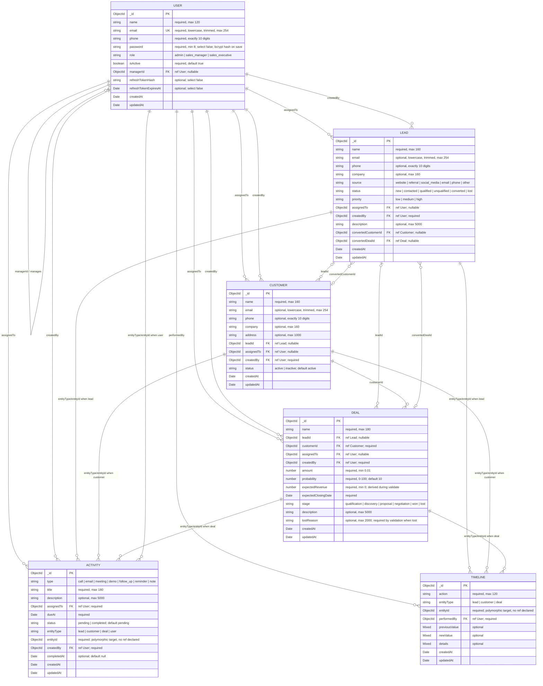

# CRM Sales Management API — Database Design

> **Source of truth:** This design is derived from the six Mongoose model definitions supplied for this project. Field names, enums, defaults, validation rules, references, timestamps, and declared indexes below reflect those definitions. MongoDB does not enforce SQL-style foreign keys for Mongoose `ref` fields.

## 1. Entity relationship diagram

Paste this Mermaid code into GitHub Markdown, Mermaid Live Editor, or a compatible Mermaid viewer.

**Diagram interpretation:** `FK` labels indicate Mongoose `ref` fields or logical polymorphic links. MongoDB itself does not create or enforce relational foreign keys. `ACTIVITY.entityId` and `TIMELINE.entityId` intentionally have no Mongoose `ref`; their target is determined by `entityType`. Mermaid relationship cardinalities around optional and polymorphic references are illustrative because these are application-level ObjectId references, not database-enforced constraints.

## 2. Exact schema configuration

All six models use Mongoose `{ timestamps: true, versionKey: false }`. Therefore Mongoose manages `createdAt` and `updatedAt`, and the default `__v` version key is disabled.

### User collection (`User` model)

| Field | Mongoose type | Required | Default / validation / behavior |
|---|---|---:|---|
| `name` | String | Yes | Trimmed; max 120 |
| `email` | String | Yes | Lowercase, trimmed; max 254; unique index |
| `phone` | String | Yes | Trimmed; exactly 10 digits |
| `password` | String | Yes | Min length 8; `select: false`; bcrypt hash with cost 12 in `pre("save")` when modified |
| `role` | String | Yes | Enum `admin`, `sales_manager`, `sales_executive`; default `sales_executive` |
| `isActive` | Boolean | Yes | Default `true` |
| `managerId` | ObjectId, ref `User` | No | Default `null`; self-reference |
| `refreshTokenHash` | String | No | `select: false` |
| `refreshTokenExpiresAt` | Date | No | `select: false` |
| `createdAt` | Date | Automatic | Mongoose timestamp |
| `updatedAt` | Date | Automatic | Mongoose timestamp |

Declared indexes:
- `{ email: 1 }` unique
- `{ role: 1 }`
- `{ managerId: 1, isActive: 1 }`

### Lead collection (`Lead` model)

| Field | Mongoose type | Required | Default / validation |
|---|---|---:|---|
| `name` | String | Yes | Trimmed; max 160 |
| `email` | String | No | Lowercase, trimmed; max 254 |
| `phone` | String | No | Trimmed; exactly 10 digits |
| `company` | String | No | Trimmed; max 160 |
| `source` | String | Yes | Enum `website`, `referral`, `social_media`, `email`, `phone`, `other`; default `other` |
| `status` | String | Yes | Enum `new`, `contacted`, `qualified`, `unqualified`, `converted`, `lost`; default `new` |
| `priority` | String | Yes | Enum `low`, `medium`, `high`; default `medium` |
| `assignedTo` | ObjectId, ref `User` | No | Default `null` |
| `createdBy` | ObjectId, ref `User` | Yes | No default |
| `description` | String | No | Trimmed; max 5000 |
| `convertedCustomerId` | ObjectId, ref `Customer` | No | Default `null` |
| `convertedDealId` | ObjectId, ref `Deal` | No | Default `null` |
| `createdAt` / `updatedAt` | Date | Automatic | Mongoose timestamps |

Declared indexes:
- `{ status: 1, createdAt: -1 }`
- `{ source: 1, createdAt: -1 }`
- `{ assignedTo: 1, createdAt: -1 }`
- `{ createdAt: -1 }`
- `{ email: 1 }`

### Customer collection (`Customer` model)

| Field | Mongoose type | Required | Default / validation |
|---|---|---:|---|
| `name` | String | Yes | Trimmed; max 160 |
| `email` | String | No | Lowercase, trimmed; max 254 |
| `phone` | String | No | Trimmed; exactly 10 digits |
| `company` | String | No | Trimmed; max 160 |
| `address` | String | No | Trimmed; max 1000 |
| `leadId` | ObjectId, ref `Lead` | No | Default `null` |
| `assignedTo` | ObjectId, ref `User` | No | Default `null` |
| `createdBy` | ObjectId, ref `User` | Yes | No default |
| `status` | String | Yes | Enum `active`, `inactive`; default `active` |
| `createdAt` / `updatedAt` | Date | Automatic | Mongoose timestamps |

Declared indexes:
- `{ email: 1 }` (not unique)
- `{ assignedTo: 1, createdAt: -1 }`
- `{ status: 1, createdAt: -1 }`
- `{ createdAt: -1 }`

### Deal collection (`Deal` model)

| Field | Mongoose type | Required | Default / validation |
|---|---|---:|---|
| `name` | String | Yes | Trimmed; max 180 |
| `leadId` | ObjectId, ref `Lead` | No | Default `null` |
| `customerId` | ObjectId, ref `Customer` | Yes | No default |
| `assignedTo` | ObjectId, ref `User` | No | Default `null` |
| `createdBy` | ObjectId, ref `User` | Yes | No default |
| `amount` | Number | Yes | Minimum 0.01 |
| `probability` | Number | Yes | Min 0, max 100; default 10 |
| `expectedRevenue` | Number | Yes | Min 0; default 0, recalculated by pre-validation hook |
| `expectedClosingDate` | Date | Yes | No default |
| `stage` | String | Yes | Enum `qualification`, `discovery`, `proposal`, `negotiation`, `won`, `lost`; default `qualification` |
| `description` | String | No | Trimmed; max 5000 |
| `lostReason` | String | No | Trimmed; max 2000; required by pre-validation when stage is `lost` |
| `createdAt` / `updatedAt` | Date | Automatic | Mongoose timestamps |

Pre-validation behavior:
- `stage === "won"`: sets `probability = 100` and `expectedRevenue = amount`.
- `stage === "lost"`: sets `expectedRevenue = 0`; invalidates `lostReason` if it is missing or blank.
- Any other stage: sets `expectedRevenue = round(amount * probability / 100, 2)`.

Declared indexes:
- `{ stage: 1, createdAt: -1 }`
- `{ assignedTo: 1, createdAt: -1 }`
- `{ expectedClosingDate: 1 }`
- `{ customerId: 1, createdAt: -1 }`
- `{ leadId: 1 }`

### Activity collection (`Activity` model)

| Field | Mongoose type | Required | Default / validation |
|---|---|---:|---|
| `type` | String | Yes | Enum `call`, `email`, `meeting`, `demo`, `follow_up`, `reminder`, `note` |
| `title` | String | Yes | Trimmed; max 180 |
| `description` | String | No | Trimmed; max 5000 |
| `assignedTo` | ObjectId, ref `User` | Yes | No default |
| `dueAt` | Date | Yes | No default |
| `status` | String | Yes | Enum `pending`, `completed`; default `pending` |
| `entityType` | String | Yes | Enum `lead`, `customer`, `deal`, `user` |
| `entityId` | ObjectId | Yes | No `ref`; target model selected by `entityType` |
| `createdBy` | ObjectId, ref `User` | Yes | No default |
| `completedAt` | Date or null | No | Default `null` |
| `createdAt` / `updatedAt` | Date | Automatic | Mongoose timestamps |

Declared indexes:
- `{ dueAt: 1 }`
- `{ assignedTo: 1, status: 1, dueAt: 1 }`
- `{ entityType: 1, entityId: 1, createdAt: -1 }`
- `{ createdAt: -1 }`

### Timeline collection (`Timeline` model)

| Field | Mongoose type | Required | Default / validation |
|---|---|---:|---|
| `action` | String | Yes | Trimmed; max 120 |
| `entityType` | String | Yes | Enum `lead`, `customer`, `deal` |
| `entityId` | ObjectId | Yes | No `ref`; target model selected by `entityType` |
| `performedBy` | ObjectId, ref `User` | Yes | No default |
| `previousValue` | Mixed | No | Arbitrary value |
| `newValue` | Mixed | No | Arbitrary value |
| `details` | Mixed | No | Arbitrary value/object |
| `createdAt` / `updatedAt` | Date | Automatic | Mongoose timestamps |

Declared indexes:
- `{ entityType: 1, entityId: 1, createdAt: -1 }`
- `{ performedBy: 1, createdAt: -1 }`

## 3. Relationship summary

- **User → User:** `managerId` optionally references another User.
- **User → Lead:** `assignedTo` optionally assigns a lead; `createdBy` records its creator.
- **User → Customer:** `assignedTo` optionally assigns a customer; `createdBy` records its creator.
- **User → Deal:** `assignedTo` optionally assigns a deal; `createdBy` records its creator.
- **Lead → Customer:** `Customer.leadId` optionally references the source Lead; `Lead.convertedCustomerId` optionally points to the converted Customer.
- **Lead → Deal:** `Deal.leadId` optionally references a Lead; `Lead.convertedDealId` optionally points to the created Deal.
- **Customer → Deal:** every Deal must reference one Customer through required `customerId`.
- **User → Activity:** each Activity must have `assignedTo` and `createdBy` User references.
- **Activity → Lead/Customer/Deal/User:** polymorphic pair `entityType` + `entityId`; no `ref` is declared on `entityId`.
- **User → Timeline:** `performedBy` records the User who performed the action.
- **Timeline → Lead/Customer/Deal:** polymorphic pair `entityType` + `entityId`; no `ref` is declared on `entityId`.

## 4. Important implementation notes

1. **No SQL foreign keys:** `ref` is Mongoose population metadata. The application must ensure referenced documents exist and handle deletes/updates.
2. **Optional email is not unique:** Lead and Customer email indexes are non-unique. Only User email has a unique index.
3. **Password storage:** the field is named `password` in the schema; the save hook hashes modified values with bcrypt cost 12. The schema does not call the field `passwordHash`.
4. **Secret fields are excluded by default:** `password`, `refreshTokenHash`, and `refreshTokenExpiresAt` use `select: false`.
5. **Polymorphic entity references:** Activity can point to a User as well as a Lead, Customer, or Deal. Timeline can point to a Lead, Customer, or Deal. The schema does not attach a Mongoose `ref` to these `entityId` fields.
6. **Timestamps:** `createdAt` and `updatedAt` are generated by Mongoose's timestamps option; `__v` is disabled with `versionKey: false`.
7. **Index declarations:** this document lists the indexes explicitly declared in the supplied schemas. Whether they exist in a running database also depends on Mongoose index creation/configuration and deployment state.
8. **Hooks:** the deal calculations and lost-reason rule are implemented in a `pre("validate")` hook. The password hashing hook is a `pre("save")` hook; code paths that bypass document save hooks need separate care.
9. **No unprovided fields added:** this design does not assume other properties, middleware, controllers, API rules, or additional indexes beyond the code supplied.

## 5. Collection names

Mongoose model names are `User`, `Lead`, `Customer`, `Deal`, `Activity`, and `Timeline`. With Mongoose's default collection naming behavior, these normally map to lowercase plural collection names:

- `users`
- `leads`
- `customers`
- `deals`
- `activities`
- `timelines`

If the application explicitly configures collection names elsewhere, that configuration takes precedence.
