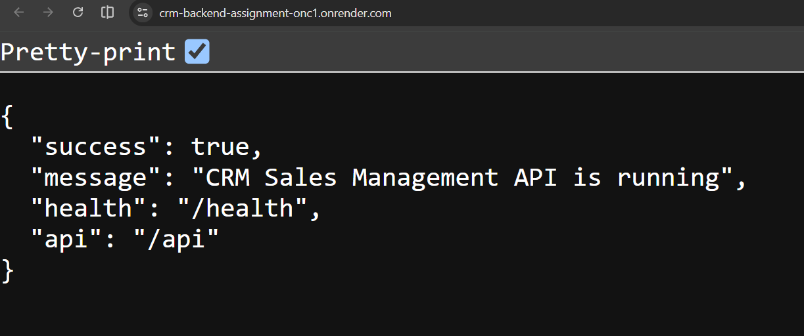
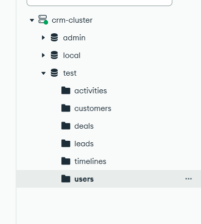
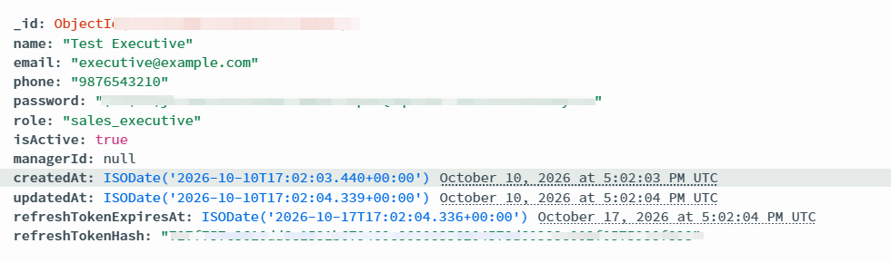
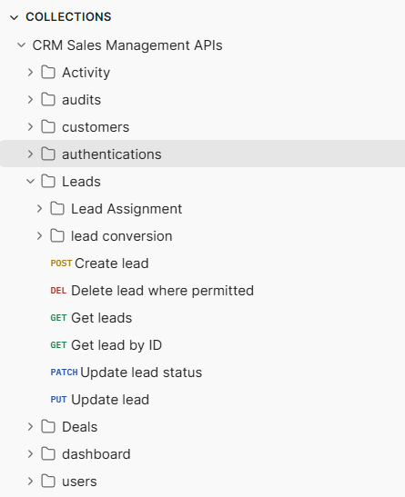

# CRM Sales Management API

A REST API for a Sales CRM built with Node.js, TypeScript, Express, MongoDB, and Mongoose. It manages users, leads, customers, deals, activities, timelines, and sales analytics with request validation and role-based access control.

For setup instructions, see [SETUP.md](SETUP.md). For authentication and permissions, see [AUTHENTICATION.md](AUTHENTICATION.md). For API examples, see [API_EXAMPLES.md](API_EXAMPLES.md).

See [PROJECT_LINKS.md](PROJECT_LINKS.md) for repository, deployment, and database-design links.

## Live Deployment

The CRM Sales Management API is deployed on Render.

- **Live API:** https://crm-backend-assignment-onc1.onrender.com/
- **Health Check:** https://crm-backend-assignment-onc1.onrender.com/health
- **API Base URL:** https://crm-backend-assignment-onc1.onrender.com/api
- **GitHub Repository:** https://github.com/biswajeet787/crm-backend-assignment

The root endpoint returns a welcome message. The health endpoint reports the API status and database connection state.

### Live API Homepage

The following screenshot shows the deployed API responding successfully.



## Project Structure

```text
crm-backend-assignment/
├── source-code/          TypeScript API and database scripts
├── api-documentation/    Postman request workspace
├── screenshots/          API, MongoDB, and Postman screenshots
├── API_EXAMPLES.md       API request and response examples
├── AUTHENTICATION.md     Authentication guide
├── PROJECT_LINKS.md      Project links
├── SETUP.md              Installation and troubleshooting
└── README.md
```

## Technologies

- Node.js and TypeScript
- Express.js
- MongoDB and Mongoose
- Zod validation
- JWT authentication
- bcryptjs password hashing
- HTTP-only refresh-token cookies
- Helmet, CORS, Morgan, and express-rate-limit

## Features

- User registration and login
- Access-token authentication and refresh-token rotation
- Role-based authorization
- User and manager management
- Lead CRUD, assignment, status management, and conversion
- Customer management
- Deal management and stage transitions
- Sales activities and completion tracking
- Timeline and history records
- Sales analytics and team performance
- Pagination, filtering, and validation
- MongoDB indexes and transaction-based lead conversion

## Installation

Install an active Node.js LTS version.

From the project root, run:

```powershell
Set-Location .\source-code
npm install
```

Create a `source-code/.env` file using the environment variables described below.

Start the development server:

```powershell
npm run dev
```

The API listens on `http://localhost:5000` by default.

Test the health endpoint:

```powershell
Invoke-RestMethod http://localhost:5000/health
```

Check the `database` field in the response before using database-backed endpoints.

For macOS or Linux, use `cd source-code` instead of `Set-Location .\source-code`.

See [SETUP.md](SETUP.md) for complete setup instructions.

## Environment Variables

Create a local file at `source-code/.env`.

| Variable | Required | Description |
|---|---|---|
| `NODE_ENV` | No | Environment: development, test, or production |
| `PORT` | No | HTTP port; defaults to 5000 |
| `MONGODB_URI` | Yes | MongoDB connection string |
| `JWT_SECRET` | Yes | Access-token signing secret; at least 32 characters |
| `JWT_REFRESH_SECRET` | Yes | Refresh-token secret; at least 32 characters and different from `JWT_SECRET` |
| `ACCESS_TOKEN_TTL` | No | Access-token lifetime; defaults to `2h` |
| `CORS_ORIGIN` | No | Comma-separated allowed browser origins |
| `SEED_ADMIN_NAME` | For admin seeding | Initial administrator name |
| `SEED_ADMIN_EMAIL` | For admin seeding | Initial administrator email |
| `SEED_ADMIN_PHONE` | For admin seeding | Initial administrator phone |
| `SEED_ADMIN_PASSWORD` | For admin seeding | Initial administrator password |

Example MongoDB Atlas connection string:

```dotenv
MONGODB_URI=mongodb+srv://<username>:<password>@<cluster-host>/crm_sales_db?retryWrites=true&w=majority&appName=crm-cluster
```

Replace the placeholders with your actual Atlas credentials and cluster hostname. Preserve the connection options supplied by Atlas if they differ. URL-encode special characters in the password when required.

Never commit `.env` or real credentials to GitHub. Use `.env.example` with placeholder values instead.

The `SEED_ADMIN_*` variables are only needed when running `npm run seed:admin`.

## Database Setup

This project uses MongoDB Atlas as its cloud database and Mongoose for database connectivity, schema validation, relationships, timestamps, and indexes.

### MongoDB Atlas Configuration

1. Create an account at [MongoDB Atlas](https://cloud.mongodb.com/).
2. Create a project for the CRM Sales Management System.
3. Create a cluster. The Free tier is suitable for development and testing.
4. Create a database user with a strong password and appropriate permissions.
5. Configure the Atlas IP Access List to permit connections from the required network locations.
6. Open your cluster and select **Connect → Drivers**.
7. Select Node.js and copy the connection string.
8. Add the connection string to `MONGODB_URI` in `source-code/.env`.

For the deployed service, configure `MONGODB_URI` through the Render environment settings rather than committing credentials to the repository.

### Database Initialization

Mongoose models define the application's schemas, relationships, validation rules, timestamps, and indexes.

MongoDB generally creates the database and collections when the application first writes data to them.

The intended application database name is `crm_sales_db`. Confirm that the database name in `MONGODB_URI` matches this name. If the URI specifies another database, MongoDB will use that database instead.

The server uses a 10-second server-selection timeout. The HTTP listener may start even if the database connection fails. Check `GET /health` before using database-backed endpoints.

### Database Collections

| Collection | Purpose |
|---|---|
| `users` | User accounts, roles, and manager relationships |
| `leads` | Potential customers and lead management |
| `customers` | Customer records |
| `deals` | Sales opportunities and deal information |
| `activities` | Calls, meetings, tasks, and sales activities |
| `timelines` | Historical events associated with CRM records |

### Database Screenshots

#### MongoDB Atlas Collections

The following screenshot shows the collections used by the CRM backend.



#### MongoDB User Document

This screenshot demonstrates a stored user document. Ensure that personal information, password hashes, refresh-token hashes, and other sensitive values are redacted before publishing.



### Database Indexes

Mongoose schemas define indexes to support common queries, filtering, sorting, and record lookups.

| Model | Indexes documented in the project |
|---|---|
| User | Unique email; role; manager and active status |
| Lead | Status/source/assignee with creation date; creation date; email |
| Customer | Email; assignee/status with creation date; creation date |
| Deal | Stage/assignee with creation date; expected close date; customer with creation date; lead |
| Activity | Due date; assignee/status/due date; linked entity with creation date; creation date |
| Timeline | Linked entity with creation date; actor with creation date |

Mongoose creates indexes automatically when configured to do so. In production, automatic index creation is disabled; run `npm run db:indexes` from `source-code/` when indexes need to be created.

### Transactions

Lead conversion creates a customer, deal, and timeline events in one MongoDB transaction.

MongoDB transactions require a replica set or sharded cluster. MongoDB Atlas supports transactions on supported cluster configurations. Verify transaction support before testing lead conversion against another MongoDB deployment.

## Running the Server

Run these commands from `source-code/`.

| Command | Purpose |
|---|---|
| `npm run dev` | Run the TypeScript server with automatic restarts |
| `npm run typecheck` | Check TypeScript types |
| `npm run build` | Compile the source into `dist/` |
| `npm start` | Run the compiled server after building |
| `npm run seed:admin` | Create the initial administrator from environment variables |
| `npm run db:indexes` | Explicitly create indexes for application models |

## Authentication Mechanism

Login and registration return a signed access token in the JSON response and set a `crm_refresh` HTTP-only cookie.

Send the access token in the following header for protected requests:

```http
Authorization: Bearer <token>
```

The access-token lifetime defaults to two hours. The refresh cookie lasts seven days. `POST /api/auth/refresh` rotates the refresh session and returns a new access token. Logout requires an access token and clears the refresh cookie.

Passwords are hashed before being stored.

**Security note:** The existing registration schema was identified as potentially accepting a caller-supplied `role`, including `admin`, although registration defaults to `sales_executive`. If this behavior is still present in the code, an unauthenticated caller could request a privileged role. Public registration should assign the permitted public role on the server and ignore or reject privileged role values supplied by clients. Verify and fix this before treating the API as production-ready.

See [AUTHENTICATION.md](AUTHENTICATION.md) for further details.

## User Roles and Permissions

Permissions are checked by route. Some services also enforce assignment and team constraints.

| Role | Main permissions |
|---|---|
| `admin` | User management, CRM operations, lead assignment and conversion, and team analytics |
| `sales_manager` | Lead, customer, deal, activity, timeline, summary, pipeline, and team-performance operations; user-management permissions are not enabled |
| `sales_executive` | CRM operations allowed by configured permissions; assigned-lead access; no user management, lead assignment or conversion, deal deletion, or team-performance analytics |

Sales executives are limited to assigned records where record-level checks apply. Managers can assign records to active sales executives who report directly to them.

See [AUTHENTICATION.md](AUTHENTICATION.md) for route-level permission details.

## Important Business Rules

- **Leads:** Status transitions are validated. Only admins and sales managers can convert a qualified lead. Converted leads cannot be reassigned or have their status changed.
- **Lead conversion:** A successful conversion atomically creates and links one customer and one deal, then marks the lead converted. The expected closing date must not be in the past. A lead with existing related records cannot be deleted.
- **Deals:** Stages progress from `qualification` through `discovery`, `proposal`, and `negotiation` to `won`. An open deal can also move to `lost`. Closed deals cannot be reopened. A lost deal requires a reason.
- **Expected revenue:** For an open deal, expected revenue is `amount * probability / 100`, rounded to two decimal places. Won deals have 100% probability; lost deals have zero expected revenue.
- **Activities:** Activities link to a lead, customer, deal, or user and must be assigned to an active user. Overdue pending activities are reported as `overdue` and remain stored as pending until completed.
- **Users and input:** Emails are normalized to lowercase and must be unique. Phone numbers must contain exactly ten digits. Invalid request bodies and query parameters are rejected by validation middleware.
- **History:** Timeline events are recorded for supported actions, including lead status changes and conversion, deal stage changes, and activity creation, reassignment, completion, and deletion.

## Assumptions Made

These assumptions are inferred from the current models and service code and should be checked against the assignment requirements:

- The deployment represents one shared CRM workspace. The models do not include a tenant or workspace identifier.
- Deal amounts use one deployment-wide currency. There is no currency field in the deal model.
- Phone numbers use a ten-digit local format.
- A sales manager's team consists of users whose `managerId` points directly to that manager.
- Public sign-up appears intended to create sales executives. Verify that the implementation does not allow clients to assign privileged roles.

## API Route Map

All application routes are under `/api`. The health endpoint is public at `/health`. The root endpoint `/` returns an API welcome message.

| Area | Routes |
|---|---|
| Root | `GET /` |
| Health | `GET /health` |
| Authentication | `POST /api/auth/register`, `POST /api/auth/login`, `POST /api/auth/refresh`, `POST /api/auth/logout`, `GET /api/auth/me` |
| Users | `GET /api/users`, `POST /api/users`, `GET /api/users/:id`, `PATCH /api/users/:id`, `PATCH /api/users/:id/status`, `DELETE /api/users/:id` |
| Leads | `GET /api/leads`, `GET /api/leads/assigned-to-me`, `POST /api/leads`, `GET /api/leads/:id`, `PATCH /api/leads/:id`, `PATCH /api/leads/:id/status`, `PATCH /api/leads/:id/assignment`, `POST /api/leads/:id/convert`, `DELETE /api/leads/:id` |
| Customers | `GET /api/customers`, `POST /api/customers`, `GET /api/customers/:id`, `PATCH /api/customers/:id`, `DELETE /api/customers/:id` |
| Deals | `GET /api/deals`, `POST /api/deals`, `GET /api/deals/:id`, `PATCH /api/deals/:id`, `PATCH /api/deals/:id/stage`, `DELETE /api/deals/:id` |
| Activities | `GET /api/activities`, `POST /api/activities`, `GET /api/activities/:id`, `PATCH /api/activities/:id`, `PATCH /api/activities/:id/complete`, `DELETE /api/activities/:id` |
| Timeline | `GET /api/timeline/:entityType/:entityId` |
| Analytics | `GET /api/analytics/summary`, `GET /api/analytics/pipeline`, `GET /api/analytics/team-performance` |

List endpoints support pagination and resource-specific filters. Successful responses use a structure such as:

```json
{
  "success": true,
  "message": "...",
  "data": {},
  "meta": {}
}
```

Error responses use a structure such as:

```json
{
  "success": false,
  "message": "...",
  "details": []
}
```

The exact response fields depend on the endpoint.

- [Database Design](DATABASE_DESIGN.md)

## Postman Requests

The Postman request workspace is available in [`api-documentation/postman/collections/CRM Sales Management APIs`](api-documentation/postman/collections/CRM%20Sales%20Management%20APIs).

For easy import into Postman, use the exported collection JSON file:

[**Download the CRM Sales Management APIs Collection**](api-documentation/postman/CRM-Sales-Management-APIs.postman_collection.json)

### Local API

For local testing, set the Postman `baseUrl` to:

```text
http://localhost:5000/api
```

### Deployed API

For testing the hosted backend, set the Postman `baseUrl` to:

```text
https://crm-backend-assignment-onc1.onrender.com/api
```

Register or sign in, then use the returned access token for protected requests. Postman should retain the refresh cookie for refresh and logout calls.

### Postman Collection Screenshot



See [API_EXAMPLES.md](API_EXAMPLES.md) and [SETUP.md](SETUP.md) for request examples and setup instructions.

## Troubleshooting

- **Database connection fails:** Check `MONGODB_URI`, Atlas IP Access List, database credentials, and network connectivity.
- **Database does not appear in Atlas:** MongoDB generally creates the database after the first successful write. Check the database name in the URI and refresh Data Explorer.
- **API root:** Open `/` to see the welcome message, or open `/health` to verify API and database status.
- **Request validation fails:** Read the `details` array and provide the required fields.
- **Lead conversion fails:** Confirm that the MongoDB deployment supports transactions.
- **Protected endpoint returns `401` or `403`:** Sign in, send the access token as `Authorization: Bearer <token>`, and confirm the user's role has permission for that route.
